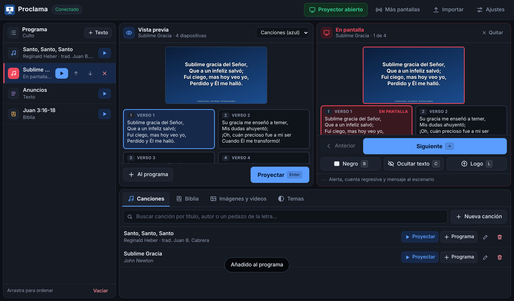
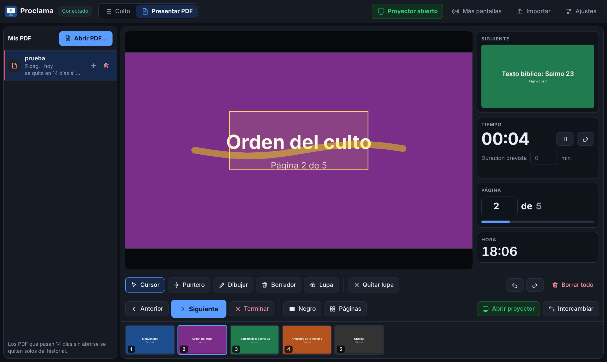

# Proclama

Software de presentación para iglesias: letras de canciones, Biblia, imágenes y videos, programa del culto,
pantalla de escenario y control remoto desde el celular. Reúne ideas de EasyWorship
(programa + vista previa + en vivo) y de Holyrics (API de control, salida para transmisión, control web),
con código propio y sin dependencias.



## Instalar en Windows (lo más fácil)

[**⬇ Descargar Proclama-Setup-0.4.0.exe**](https://github.com/sanmiguelyt955/Proclama/raw/main/instaladores/Proclama-Setup-0.4.0.exe) (sin ZIP) y ejecútalo. No pide permisos de
administrador ni necesita instalar Node: deja un icono **Proclama** en el escritorio y en el menú Inicio.

- Requiere Windows 10 u 11 de 64 bits.
- Como el instalador no está firmado, Windows puede mostrar «Windows protegió su PC»: pulsa **Más información → Ejecutar
  de todas formas**.
- La primera vez, el Firewall de Windows pregunta si permite el acceso a la red: acéptalo en **redes privadas** para poder
  usar el control remoto desde el celular y las demás pantallas.
- Se abre en su propia ventana (usa Edge o Chrome, sin pestañas) y se cierra sola poco después de cerrar la última ventana.
- Tus canciones, Biblias, medios y ajustes quedan en `%APPDATA%\Proclama` y se conservan al actualizar, reinstalar o
  desinstalar. El registro de errores está ahí mismo, en `proclama.log`.

Para generar el instalador: `node tools/build-installer.mjs` (necesita `makensis`; en Linux, `apt install nsis`).

## Instalar en Linux

```bash
git clone https://github.com/sanmiguelyt955/Proclama && cd Proclama
bash tools/install-linux.sh
```

Sin permisos de administrador. Usa tu Node si es 22.5 o más nuevo; si no, descarga uno propio (verificado con la huella oficial).
Crea el icono **Proclama** en el menú de aplicaciones y el comando `proclama`. Para quitarlo: `bash tools/install-linux.sh --quitar`
(tus datos en `~/.local/share/proclama` se conservan). Probado en Ubuntu 24.04; no en Linux Mint.

## Presentar un PDF

1. En la cabecera, **Presentar PDF**. Pulsa **Abrir PDF…** o arrastra el archivo a la ventana (hasta 500 páginas).
2. Pulsa **Abrir proyector** y lleva esa ventana a la segunda pantalla (con Chrome o Edge se coloca sola; pulsa `F` para pantalla completa).
3. Pulsa **Proyectar** (`Enter`). Avanza con `→`, `←` o espacio; también desde el celular en `/remote`.

| Tecla | Acción | Tecla | Acción |
|---|---|---|---|
| `→ ↓ Av Pág espacio` | Siguiente | `L` | Puntero láser |
| `← ↑ Re Pág` | Anterior | `H` · `1`–`7` | Dibujar · elegir resaltador o lápiz |
| `Inicio` · `Fin` | Primera · última | `0` o `E` | Borrador |
| `G` | Ir a una página | `Ctrl+Z` · `Ctrl+Mayús+Z` | Deshacer · rehacer |
| `D` | Ver todas las páginas | `Z` · `U` | Lupa · quitar lupa |
| `B` | Pantalla en negro | `P` · `R` · `T` | Pausar · reiniciar · duración prevista |
| `S` | Intercambiar pantallas | `Esc` | Salir de lo último que abriste, y al final, terminar |

## Cómo usarlo (sin instalador)

En macOS o Linux, o para desarrollar, con Node instalado también puedes abrirla como app de escritorio con
`node launcher.mjs`, o solo el servidor como se explica aquí.


Necesitas [Node.js](https://nodejs.org) 22.5 o más nuevo. No hay nada que instalar.

```bash
cd proclama
node server.js          # o: npm start
```

Abre `http://localhost:7700`. El flujo es **elige → revisa → proyecta**: toca una canción o un pasaje, míralo en la vista
previa y pulsa **Proyectar**. El botón **Abrir proyector** abre la ventana para la segunda pantalla (se pone verde cuando
está conectada) y en **Más pantallas** están los enlaces a las demás vistas:

| Vista | Dirección | Para qué |
|---|---|---|
| Operador | `/` | Biblioteca, programa, vista previa y control en vivo |
| Proyector | `/output` | Llévala a la segunda pantalla y pulsa `F` (pantalla completa) |
| Escenario | `/stage` | Letra actual y siguiente, reloj, cuenta regresiva y mensajes a los músicos |
| Control remoto | `/remote` | Desde el celular, en la misma red Wi-Fi |

Otro puerto: `PORT=8080 node server.js`. Los datos (canciones, temas, programa, medios) se guardan en `proclama/data/`
(cambia la carpeta con `PROCLAMA_DATA`). Para exigir una clave a los dispositivos de la red: `PROCLAMA_TOKEN=clave node server.js`
y abre los enlaces con `?token=clave`.

**Sin servidor:** la carpeta `public/` también funciona como sitio estático (cualquier hosting). En ese «modo local» los datos
se guardan en el navegador y las pantallas solo se sincronizan entre ventanas del mismo navegador; no hay control desde otros
dispositivos, API ni importación de EasyWorship.

## Qué hace

- **Canciones**: biblioteca con búsqueda por título, autor o letra. Secciones (`Verso 1`, `Coro`, `Puente`…), una línea en
  blanco separa diapositivas, orden opcional (`V1 C V2 C P C`), autor, copyright y CCLI en el pie.
- **Biblia**: Reina-Valera 1909 y King James (dominio público). Escribe `Juan 3:16-18`, `jn 3 16` o `1 co 13`, o busca por
  palabras. Uno o varios versículos por diapositiva.
- **Medios**: imágenes y videos para mostrar o usar de fondo; imagen de logo.
- **Temas**: fuente, tamaño (se ajusta solo para que quepa), color, alineación, sombra, contorno, fondo de color, degradado,
  imagen o video. Los cambios se ven al instante, también en vivo.
- **Programa**: canciones, pasajes, medios y textos en orden; arrastra para reordenar.
- **En pantalla**: Negro, Ocultar texto (deja el fondo), Logo, alerta que cruza la pantalla, cuenta regresiva y mensaje al escenario.
- **Presentar PDF** (sección aparte, para dos pantallas): abre o arrastra un PDF y cada página es una diapositiva, sin pasarlo a
  PowerPoint. La laptop muestra la página actual, la siguiente, el cronómetro (con duración prevista y colores), el reloj y las
  herramientas; el proyector solo la página actual. Puntero láser, resaltador y lápiz con deshacer, lupa, cuadrícula de páginas,
  pantalla en negro e ir a una página. Historial «Mis PDF» que se limpia solo a las 2 semanas sin abrirlo. Estudio de la
  herramienta en que se inspira: [docs/pympress-ingenieria-inversa.md](docs/pympress-ingenieria-inversa.md).
- **Importar**: texto plano, ChordPro, OpenSong, OpenLyrics/OpenLP, JSON de Holyrics y la base de datos de
  EasyWorship 6.1+ (`Songs.db` + `SongWords.db`). Copia de seguridad en JSON.



Atajos en «Culto»: `→`/espacio siguiente · `←` anterior · `Enter` proyectar la vista previa · `B` negro · `C` ocultar texto · `L` logo.

## Pensada para equipos modestos

- Sin instalación ni dependencias: un solo proceso de Node y un navegador.
- **Modo de bajo consumo** (activado por defecto, en Ajustes): en el panel del operador los videos se ven como imagen fija
  y sin animaciones. El proyector sí los reproduce.
- Al avanzar de diapositiva solo viaja un mensaje de unos 300 bytes; las letras se envían una vez por presentación.
- Las listas largas se dibujan por partes (120 canciones a la vez) y las búsquedas usan un índice en memoria.
- El tamaño de letra de cada diapositiva se calcula una vez y se recuerda.

Medido con la CPU frenada 6× y 1500 canciones: el panel abre en 0,8 s (antes 3,2 s), buscar una canción tarda 0,07 s
(antes 0,5 s) y avanzar en un capítulo de 176 versículos tarda 30 ms (antes 120 ms).

Consejos: usa videos de fondo en MP4 H.264 a 720p, cierra otras pestañas del navegador y, si el equipo sufre con video,
usa fondos de imagen o degradado.

## API de control

Para Stream Deck, Bitfocus Companion o scripts. `GET` o `POST` (JSON) a `/api/action/<acción>`:

| Acción | Parámetros |
|---|---|
| `next`, `prev`, `close`, `status` | — |
| `goto` | `index` (empieza en 0) |
| `black`, `clear`, `logo` | `value` opcional (`1`/`0`); sin él, alterna |
| `alert` | `text` (vacío o `value=0` la quita) |
| `countdown` | `minutes` o `seconds`, `label` (0 la detiene) |
| `stage` | `text` |
| `show-song` | `id` o `title` |
| `show-verse` | `ref` (p. ej. `Juan 3:16`), `version` opcional |
| `show-text` | `title`, `text` |
| `show-media` | `id` o `name` |

```bash
curl "http://localhost:7700/api/action/show-verse?ref=Salmos%2023:1-3"
curl "http://localhost:7700/api/action/next"
```

## Añadir otra Biblia

La app trae solo traducciones de dominio público. Para usar otra que tu iglesia tenga derecho a usar (por ejemplo la
Reina-Valera 1960), cárgala en tu instalación: en la pestaña **Biblia** abre la lista de versiones y elige
**＋ Añadir otra Biblia…** (también está en **Importar → Biblias**), escribe el nombre y elige el archivo:

- **PDF** con texto seleccionable (no escaneado), con un título por capítulo («Génesis 1») y los versículos numerados.
  La app separa libros, capítulos y versículos, descarta encabezados, títulos de sección y referencias, y al terminar
  informa cuántos versículos leyó y cuáles conviene revisar (por ejemplo, si el PDF trae un número de versículo dañado).
- **JSON** con la Biblia completa, o 66 archivos JSON, uno por libro (`genesis.json`, `exodo.json`…).

También por línea de comandos:

```bash
node tools/import-bible.mjs <archivo.json | carpeta con un JSON por libro> "Reina-Valera 1960"
```

La Biblia importada se guarda en `data/bibles/` (o en el navegador, en modo local) y **no** forma parte del repositorio.
La RVR1960, la NVI y otras tienen derechos de autor: para distribuirlas dentro de la app hace falta permiso de su editor.

## Actualizaciones

La app busca sola si hay una versión nueva (al abrir y cada 6 horas). Si la hay, aparece arriba el botón
**Actualizar a X.Y.Z**: muestra las novedades y, al aceptar, descarga solo los archivos que cambiaron, guarda copia de
los anteriores en `data/backup/`, se reinicia y recarga todas las pantallas. Canciones, Biblias, medios y ajustes no se
tocan. También se puede comprobar a mano en **Ajustes → Buscar actualizaciones**. Por seguridad, solo se puede instalar
desde la computadora donde corre Proclama, y cada archivo se verifica antes de reemplazar nada.

**Publicar una versión** (cuando tú quieras):

```bash
node tools/make-release.mjs 0.4.0 "Novedad 1" "Novedad 2"   # sube la versión y genera release.json
git add -A && git commit -m "Proclama 0.4.0" && git push      # a la rama publicada (main)
```

Las instalaciones leen `release.json` de la carpeta `proclama/` de la rama `main` de este repositorio (se cambia en
`package.json` → `proclama.updateUrl`, o con la variable `PROCLAMA_UPDATE_URL`; el valor `none` desactiva las
actualizaciones). Mientras no publiques una versión con número mayor, nadie ve el botón.

## Estructura

```
server.js            servidor (HTTP, SSE, API, medios) — sin dependencias
launcher.mjs         arranque como app de escritorio (ventana propia, datos en la carpeta del usuario)
lib/easyworship.js   lector de la base de datos de EasyWorship (node:sqlite)
public/shared/       lógica común a navegador y servidor: modelo, Biblia, importadores
public/js/           operador (app.js), presentador de PDF (presenter.js, pdf-slides.js, overlay.js), motor de pantalla (render.js), sincronización (store.js)
public/*.html        operador, proyector, escenario, control remoto
test/                pruebas (`npm test`)
```

## Referencias estudiadas

Ningún código copiado; sirvieron para entender formatos y funciones:
[jamesinglis/ew61-export](https://github.com/jamesinglis/ew61-export) (esquema de EasyWorship 6.1 y letras en RTF),
[holyrics/jslib](https://github.com/holyrics/jslib) y [holyrics/JSCommunity](https://github.com/holyrics/JSCommunity)
(acciones, importadores de canciones), [wcmark/Holyrics-Web-Control](https://github.com/wcmark/Holyrics-Web-Control) (control web).

## Pendiente

Notas del presentador y videos dentro de los PDF, guardar varios programas, fondos de video en bucle por canción, editor de diapositivas con varias cajas de texto,
disparadores/scripts al estilo Holyrics, acordes para músicos, instalador para macOS, probar el intercambio de pantallas con dos monitores reales.
