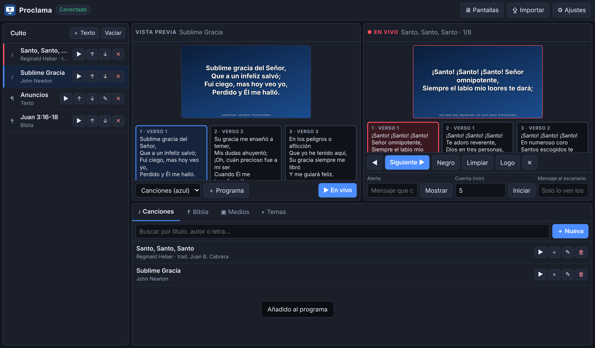

# Proclama

Software de presentación para iglesias: letras de canciones, Biblia, imágenes y videos, programa del culto,
pantalla de escenario, salida para OBS y control remoto desde el celular. Reúne ideas de EasyWorship
(programa + vista previa + en vivo) y de Holyrics (API de control, salida para transmisión, control web),
con código propio y sin dependencias.



## Cómo usarlo

Necesitas [Node.js](https://nodejs.org) 22.5 o más nuevo. No hay nada que instalar.

```bash
cd proclama
node server.js          # o: npm start
```

Abre `http://localhost:7700`. En el botón **Pantallas** están los enlaces a las demás vistas:

| Vista | Dirección | Para qué |
|---|---|---|
| Operador | `/` | Biblioteca, programa, vista previa y control en vivo |
| Proyector | `/output` | Llévala a la segunda pantalla y pulsa `F` (pantalla completa) |
| Escenario | `/stage` | Letra actual y siguiente, reloj, cuenta regresiva y mensajes a los músicos |
| OBS | `/obs?mode=lower` | Tercio inferior con fondo transparente (fuente «Navegador», 1920×1080) |
| Control remoto | `/remote` | Desde el celular, en la misma red Wi-Fi |

Otro puerto: `PORT=8080 node server.js`. Los datos (canciones, temas, programa, medios) se guardan en `proclama/data/`
(cambia la carpeta con `PROCLAMA_DATA`). Para exigir una clave a los dispositivos de la red: `PROCLAMA_TOKEN=clave node server.js`
y abre los enlaces con `?token=clave`.

**Sin servidor:** la carpeta `public/` también funciona como sitio estático (cualquier hosting). En ese «modo local» los datos
se guardan en el navegador y las pantallas solo se sincronizan entre ventanas del mismo navegador; no hay control desde otros
dispositivos, API ni importación de EasyWorship.

## Qué hace

- **Canciones**: biblioteca con búsqueda por título, autor o letra. Secciones (`Verso 1`, `Coro`, `Puente`…), una línea en
  blanco separa diapositivas, orden opcional (`V1 C V2 C P C`), autor, copyright y CCLI en el pie.
- **Biblia**: Reina-Valera 1909 y King James (dominio público). Escribe `Juan 3:16-18`, `jn 3 16` o `1 co 13`, o busca por
  palabras. Uno o varios versículos por diapositiva.
- **Medios**: imágenes y videos para mostrar o usar de fondo; imagen de logo.
- **Temas**: fuente, tamaño (se ajusta solo para que quepa), color, alineación, sombra, contorno, fondo de color, degradado,
  imagen o video. Los cambios se ven al instante, también en vivo.
- **Programa**: canciones, pasajes, medios y textos en orden; arrastra para reordenar.
- **En vivo**: Negro, Limpiar (deja el fondo), Logo, alerta que cruza la pantalla, cuenta regresiva y mensaje al escenario.
- **Importar**: texto plano, ChordPro, OpenSong, OpenLyrics/OpenLP, JSON de Holyrics y la base de datos de
  EasyWorship 6.1+ (`Songs.db` + `SongWords.db`). Copia de seguridad en JSON.

Atajos: `→`/espacio siguiente · `←` anterior · `Enter` enviar la vista previa en vivo · `B` negro · `C` limpiar · `L` logo.

## Pensada para equipos modestos

- Sin instalación ni dependencias: un solo proceso de Node y un navegador.
- **Modo de bajo consumo** (activado por defecto, en Ajustes): en el panel del operador los videos se ven como imagen fija
  y sin animaciones. El proyector sí los reproduce.
- Al avanzar de diapositiva solo viaja un mensaje de unos 300 bytes; las letras se envían una vez por presentación.
- Las listas largas se dibujan por partes (120 canciones a la vez) y las búsquedas usan un índice en memoria.
- El tamaño de letra de cada diapositiva se calcula una vez y se recuerda.

Medido con la CPU frenada 6× y 1500 canciones: el panel abre en 0,8 s (antes 3,2 s), buscar una canción tarda 0,07 s
(antes 0,5 s) y avanzar en un capítulo de 176 versículos tarda 30 ms (antes 120 ms).

Consejos: usa videos de fondo en MP4 H.264 a 720p, cierra otras pestañas del navegador y, si el equipo sufre con video,
usa fondos de imagen o degradado.

## API de control

Para Stream Deck, Bitfocus Companion o scripts. `GET` o `POST` (JSON) a `/api/action/<acción>`:

| Acción | Parámetros |
|---|---|
| `next`, `prev`, `close`, `status` | — |
| `goto` | `index` (empieza en 0) |
| `black`, `clear`, `logo` | `value` opcional (`1`/`0`); sin él, alterna |
| `alert` | `text` (vacío o `value=0` la quita) |
| `countdown` | `minutes` o `seconds`, `label` (0 la detiene) |
| `stage` | `text` |
| `show-song` | `id` o `title` |
| `show-verse` | `ref` (p. ej. `Juan 3:16`), `version` opcional |
| `show-text` | `title`, `text` |
| `show-media` | `id` o `name` |

```bash
curl "http://localhost:7700/api/action/show-verse?ref=Salmos%2023:1-3"
curl "http://localhost:7700/api/action/next"
```

## Añadir otra Biblia

La app trae solo traducciones de dominio público. Para usar otra que tu iglesia tenga derecho a usar (por ejemplo la
Reina-Valera 1960), cárgala en tu instalación: **Importar → Biblias**, escribe el nombre y elige el JSON completo o los
66 archivos JSON, uno por libro (`genesis.json`, `exodo.json`…, cada uno con una lista de capítulos y versículos).
También por línea de comandos:

```bash
node tools/import-bible.mjs <archivo.json | carpeta con un JSON por libro> "Reina-Valera 1960"
```

La Biblia importada se guarda en `data/bibles/` (o en el navegador, en modo local) y **no** forma parte del repositorio.
La RVR1960, la NVI y otras tienen derechos de autor: para distribuirlas dentro de la app hace falta permiso de su editor.

## Estructura

```
server.js            servidor (HTTP, SSE, API, medios) — sin dependencias
lib/easyworship.js   lector de la base de datos de EasyWorship (node:sqlite)
public/shared/       lógica común a navegador y servidor: modelo, Biblia, importadores
public/js/           operador (app.js), motor de pantalla (render.js), sincronización (store.js)
public/*.html        operador, proyector/OBS, escenario, control remoto
test/                pruebas (`npm test`)
```

## Referencias estudiadas

Ningún código copiado; sirvieron para entender formatos y funciones:
[jamesinglis/ew61-export](https://github.com/jamesinglis/ew61-export) (esquema de EasyWorship 6.1 y letras en RTF),
[holyrics/jslib](https://github.com/holyrics/jslib) y [holyrics/JSCommunity](https://github.com/holyrics/JSCommunity)
(acciones, importadores de canciones), [wcmark/Holyrics-Web-Control](https://github.com/wcmark/Holyrics-Web-Control) (control web).

## Pendiente

Guardar varios programas, fondos de video en bucle por canción, editor de diapositivas con varias cajas de texto,
disparadores/scripts al estilo Holyrics, acordes para músicos, empaquetado como app de escritorio (Electron/Tauri).
